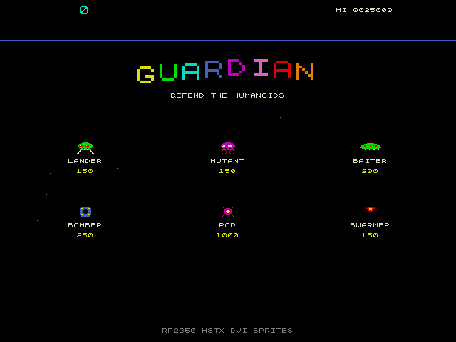
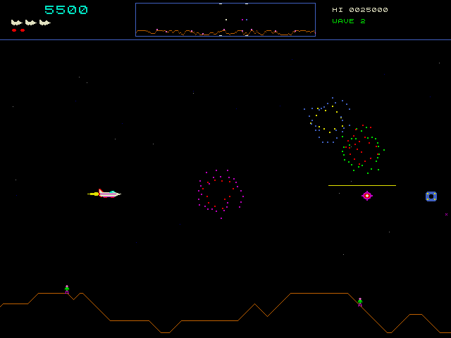
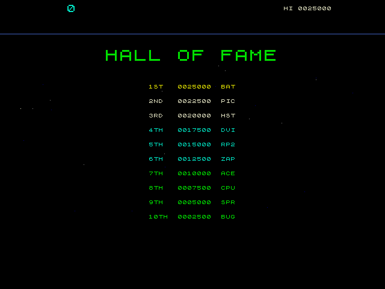

# Guardian

A side scrolling shoot 'em up in the style of the 1981 arcade classic, using sprites.

<p>
  
  
  
</p>

## Controls

Buttons connect the GPIO to ground (internal pull ups are used).

| GPIO | Button     |
|------|------------|
| 6    | Left       |
| 7    | Right      |
| 8    | Up         |
| 9    | Down       |
| 10   | Fire       |
| 11   | Smart bomb |

- Left and right turn the ship and thrust that way.
- Up and down together jump into hyperspace.
- Fire lets off a burst of three shots. Hold it for another burst after a short pause, or press it again for one straight away.
- Fire or smart bomb starts a game.

GPIOs 2 to 5 are left free for the SD card, wired as in the hstx_dvi_cpm app.
The first button GPIO can be changed with `DEF_INP_GPIO_START` in CMakeLists.txt.

Built with `-DGAME_NESPAD=ON` (see the top README), NES or SNES gamepads work as well: D-pad for the directions, A to fire and B for a smart bomb.

## The game

- The world wraps round and is several screens wide. The scanner at the top shows all of it.
- Landers carry humanoids off. Shoot the lander and catch the humanoid before it falls too far,
  then put it back down on the ground.
- A lander that gets a humanoid to the top of the screen turns into a mutant.
- Lose all the humanoids and the planet goes, turning every lander into a mutant.
  The humanoids and the planet come back every 5 waves.
- Bombers leave mines, pods burst into swarmers when shot, and baiters turn up if a wave takes too long.
- A bonus is given for each humanoid left at the end of a wave.
- An extra ship and smart bomb every 10000 points.

## Between games

The title with the enemies materialising, a demo game played by the Pico, and the hall of fame.

## How it is drawn

The sprites are handed out afresh every frame, so only what is on the screen uses one.
The mountains, scanner, laser beams and big text have their own renderers that draw straight into the row.
The mountains and scanner are drawn into one buffer while the other is shown.
These, along with the colours, pictures, explosions and high score table, are in `../common/game`, shared with the other games.

## Running on the PC

The game can be built and run on a Linux PC to try out changes without a Pico.
The sprite renderer runs in a second thread in place of core 1, and frames are saved as PPM images.

```sh
host/build.sh
host/build/defender_host play 6000 300 frames
```

The arguments are the mode, how many frames to run, how often to save one and where to put them.
The modes are `attract` (no buttons pressed), `play` (a game driven by the demo player),
`idle` (a game where the ship sits at the top), `planet` (as play, but all the humanoids are lost)
and `manual` (a game with a little scripted flying). The score, lives and enemy counts are printed
every 10 seconds of game time.

Each saved frame is about 1MB, so keep the gap between them large on long runs.

The harness itself is in `../common/host`, shared with the other games; `host/scenario.c` is what presses the buttons.
