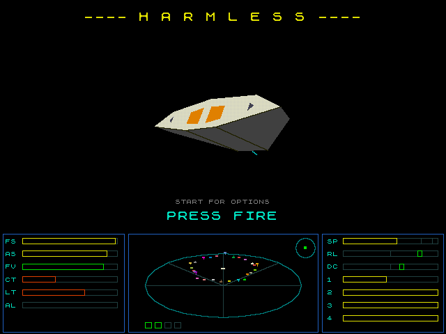
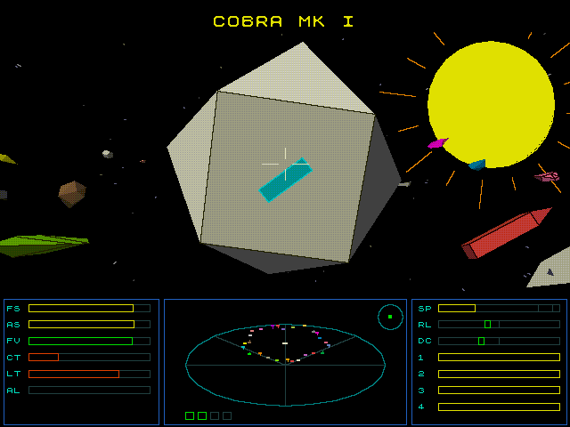
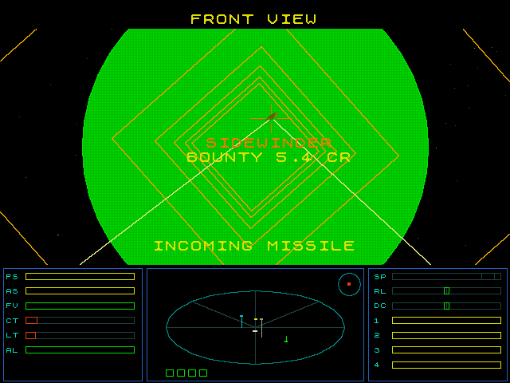
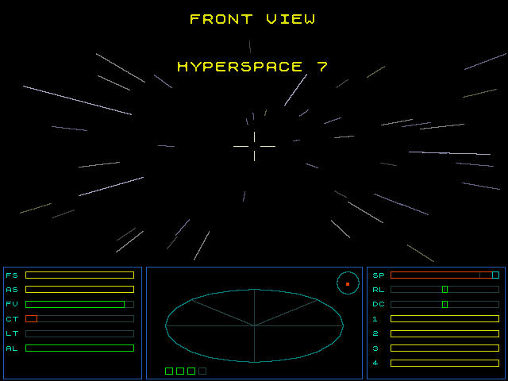
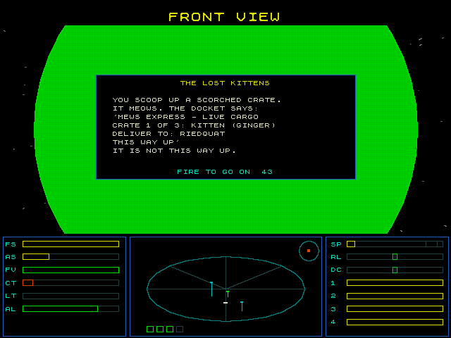
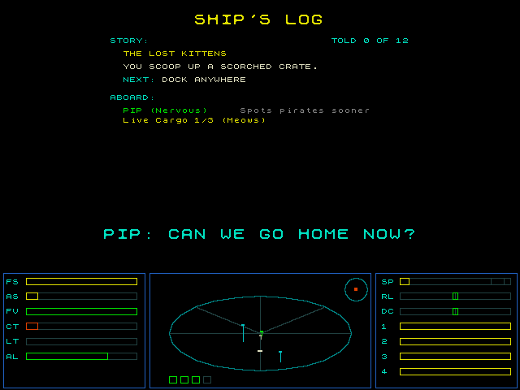
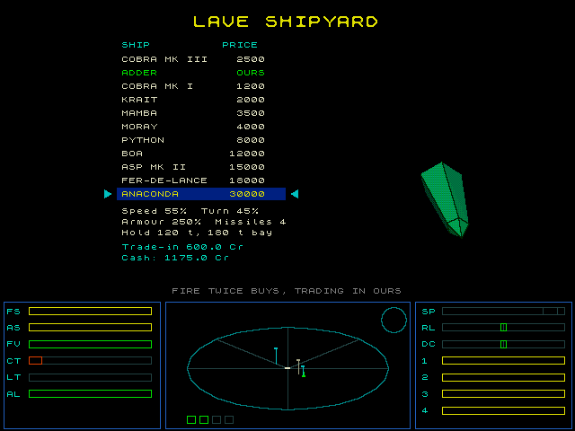
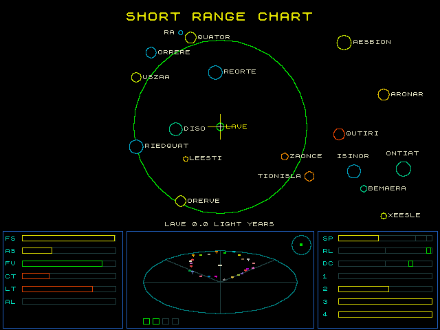

# Harmless

A game in the style of Elite, named after the rating every commander starts with, drawn in 3D with sprites, from the wireframe test. So far you can launch from the space station at Lave,
fly about, look at the charts of the galaxy and the data on its systems, jump to other systems through hyperspace, fight pirates, dock again, and trade.

<p>
  
  
</p>
<p>
  
  
</p>
<p>
  
  
</p>
<p>
  
  
</p>

## Between games

The title, with a Cobra Mk III turning, then the galactic chart, the short range chart, the data on the systems nearest us,
and every type of ship flying round a space station, the next galaxy each time round. Fire begins a game, and start shows the options.

## Docking

A game starts docked, with your status shown, as in the original. Fire launches you through the station's tunnel.
To dock again, fly into the slot from in front of it, pointing at the station, with the slot level:
the station spins, so roll to match it. Touching the station any other way, or the planet, is the end of the game.
Close in front of the slot, squares hang in space to guide you in, turning with the station, green when you are lined up
and amber when not. They are always drawn as wireframes.

Systems of tech level 10 or more have a dodecahedron station, as in the original, as big as the Coriolis station,
with the slot in the middle of its front face; it is docked with in the same way. The data on a system shows its station,
and the parade on the title shows each in turn.

A docking computer, sold from tech level 9, flies you in: out to a point in front of the slot, round the side first
if you are behind the station, then in along the line to the slot, rolling to keep it level. X on a SNES pad turns it
on and off, as does DOCKING in the options for other pads. Touching the pad or fire takes over from it.

An escape pod, sold from tech level 6, saves you when your energy runs out: you leave in it, looking back at your ship
tumbling away until it blows up, and are brought in to the station, with a new ship the same as the old but without
the cargo or the pod, a full tank and a clean record. It cannot save you from flying into the planet, the sun or the station.

An energy bomb, sold from tech level 7, destroys every ship within range of the scanner, police and traders too, and the missiles flying,
with a white flash. It is used up, and can be bought again. It goes off with three quick presses of A on a SNES pad,
within half a second; one press only arms it. On a SNES pad A is not fire: B is.

A targeting computer, sold from tech level 8 and not in the original, finds a ship within about
7 degrees of the middle of the view and in laser range, naming it at once, then takes half a second to lock on, the sights
sliding over to it in orange. Locked, they are green, and the laser hits that ship.
It keeps to the same ship while it can, and shows its name under the sights, with its bounty, or CLEAN if it has none and is not to be shot, staying a couple of seconds, in grey, after it lets go. It never follows the station, so docking is as before.

## Hyperspace

Pick a system with the cursor on the charts, then go into the overdrive and hold on: two seconds more, filling the
short cyan end of the speed gauge, start a countdown of 10 seconds to it, shown big at the top of the view,
if it is within reach of the fuel, shown by the circle round us on the charts. With the cursor on the system we are in,
it says NO HYPERSPACE COORDINATES. Slowing down, out of the overdrive, before it ends calls the jump off. The jump uses as much fuel as it is long,
up to 7 light years with full tanks, and fuel is bought at the station.
It cannot start, or end, too close to anything, the planet, the sun, the station or another ship: we are mass locked.
Each system's planet is as big as its data says and coloured as it is on the charts,
and where its sun and station are comes from its numbers, so it is the same each time.

## The galactic hyperdrive

Sold from tech level 10, it takes you to the next of the eight galaxies, and after the eighth back to the first.
On the galactic chart, B held with fire (Y with B on a SNES pad) starts a countdown of 10 seconds, as for a jump; it needs no fuel,
and you arrive at the system nearest where you were on the chart. It is used up, and can be bought again.

## Witchspace and the Thargoids

About one jump in 40 goes wrong, as in the original, and leaves you in witchspace, halfway to where you were going,
with the fuel for the whole jump spent. There is no planet, sun or station, so no docking, scooping or compass,
and the specks of dust go past in every colour, so you can tell where you are. Two or three Thargoids come for you.
Each launches up to four Thargons, small fast drones that weave, which go dead and drift when their Thargoid is destroyed.
A destroyed Thargon may leave a canister of alien items, always if it was dead. Thargoids and Thargons bring a bounty.
The charts are centred on where you are, and the only way out is a jump from there, so the Thargoids must be beaten,
or left behind, as they mass lock you. An escape pod brings you in to the system you were going to.
Now and then a Thargoid turns up in an ordinary system too.

## Trading

Docked, select also shows the market, the equipment for sale and the shipyard. In the market, up and down pick a good,
right buys and left sells, held to go on. The goods, and how their prices and how many are for sale depend on the economy,
moved a little each time we arrive, are as in Ian Bell's Text Elite. Goods sold by the tonne fill the hold, of 20 tonnes in a Cobra Mk III;
gold, platinum and gem-stones take no room. The equipment for sale depends on the tech level:
fuel, missiles, a large cargo bay (35 tonnes in a Cobra), the ECM, fuel scoops, an escape pod, an energy bomb, a targeting computer, a docking computer, a galactic hyperdrive, and pulse, beam and military lasers, the last two of which fire all the time.
A laser can go at the front, rear, left or right, chosen with left and right, in place of a lesser one there.
Like Commander Jameson you start with 100 credits, a pulse laser, three missiles and no ECM.

The shipyard sells other ships, more of them the higher the tech level, from an Adder to an Anaconda, with the one
picked turning beside the list. Each goes and turns faster or slower than a Cobra Mk III, has shields that take more
or less, and carries more or less cargo and as many as four missiles. Fire twice buys one, trading in ours for three
quarters of its price; the equipment comes too, a large cargo bay as the new ship's, and as many missiles as it carries,
but the cargo must fit. ALL SHIPS in the options puts every ship on sale, for trying them out.

## The overdrive

The sun is a long way off, so holding B and up on at full speed for half a second goes into the overdrive,
about nine times faster: the speed gauge goes red, past a mark near its end, and the sun is about 15 seconds from the planet.
It burns a tenth of a light year of fuel each second, so getting there costs about a light year and a half,
which fuel scoops soon win back. It cannot be used close to the planet, the sun, the station or another ship,
and drops out to full speed when near any of them, when out of fuel, or with B and down.

Held on for two seconds more at full overdrive, the hyperdrive starts its countdown, see Hyperspace.

## The sun, fuel scoops and canisters

Close to the sun the cabin heats up, shown by CT on the dashboard; too hot, it drains your energy, and flying into the sun is the end.
With fuel scoops fitted, flying close enough to the sun fills the tanks as you go.
A destroyed trader or pirate may leave a cargo canister drifting. With fuel scoops, fly into it, aiming at or a little below the sights,
to pick it up, which puts a tonne, kilo or gram of something at random in the hold, if there is room, and shows its name;
otherwise it breaks against the ship, taking a little off the shields, with CARGO LOST, or NO FUEL SCOOPS if none are fitted.
The inventory, one of the screens select shows, lists the cargo in the hold and the equipment fitted, with the fuel, cash and missiles.

## Combat

Fire shoots the laser the way you look, if one is fitted there, which heats up as it fires and stops when too hot until it has cooled.
A laser does all its damage out to a quarter of its reach, then less and less, to a fifth at the end of it,
so a fight is best close in. The other ships know it, and hold their fire until they are close enough to do some good.
B held with fire launches a missile at the ship nearest the middle of the view, if any are left.
B held with select sets off the ECM, if fitted, which blows up every missile flying.

The other ships are traders going about their business, pirates that come for you,
and the police, who come for you if you destroy anyone but a pirate. Anyone shot at shoots back, or runs if it is a trader badly hurt.
A ship coming at you breaks off in time to miss you, sooner the faster you are closing, turning across your way.

Shoot at the station and it turns on you: it launches four Vipers after you, one after another out of the slot,
fires its guns at you from up to 12000 away, and keeps its doors shut, so trying to dock is the end of you,
and the docking computer refuses. You are an offender. It lasts until you leave the system, or escape in the pod.
Each type of ship has a character, loosely after the original:

- Light fighters, the Sidewinder, Gecko and Worm, are fast and weave as they come, small and hard to hit, but fragile and weak.
- The Mamba, Krait, Adder and Cobra Mk I are all-rounders.
- The Asp Mk II and Fer-de-Lance are heavy fighters: fast, tough and hard hitting, for a big bounty.
- The Python, Boa and Anaconda are slow and turn badly, but are tough, hit hard from further off than the rest and keep their distance,
  and may fire missiles: deadly head on, but easy to get behind.
- The police fly Vipers, fast and accurate.

Each system has a character from its data. Where the government is weak there are more pirates, and more of them heavy fighters;
where it is strong, more police. The more people, the busier it is, and industrial systems see the big freighters.
Hits take your shields down, fore or aft, then your energy, and they build up again slowly. With no energy left the game is over.
Pirates and Thargoids bring a bounty, shown when you destroy one, some wanted more than others of their type, and the ships destroyed raise your rating, as in the original.

## Stories and companions

Now and then, docking or coming into a system, a story finds you: a basket of lost kittens in space, a princess
held by the Black Baron, a race between a tortoise and a hare, a Thargoid that wants to go home, a pirate's parrot
who knows where the gold is, a wedding cake to deliver in one piece, a trader whose captain has turned into a Thargon,
an old admiral with two singing whales, and a farm boy who flies with his eyes shut.
Each goes across a few nearby systems, picked when it starts, and has choices that matter. They show as pages over
the view, while the game goes on: up and down pick a choice, and fire takes it, and in flight the other controls still
fly, though the ship slows to a tenth of full speed, out of any overdrive, to read it. Left for 45 seconds in flight,
a page goes, taking the second choice, which leaves things be; docked, it waits. Only one goes at a time, and none
needs signing up for.

The ship's log, one of the screens select shows, has the story going, or the one last told, as it went: how each
page began and the choice made on it; then what it waits for next, who and what is aboard, and how many stories
have been told.

Stories put named items aboard, shown on the inventory, and may leave a ship to disable rather than destroy:
hit hard, it goes dark and drifts, and leaves what it carried in a canister. A story's canister is taken aboard
without fuel scoops.

A companion may fly with you, given a passenger cabin, 100 Cr from tech level 1, which takes 5 tonnes of the hold:
Pip, a nervous navigator who sees pirates further off; Marge, the ship's engineer, who patches the shields once a
fight; Sly, a retired smuggler, who sells for a tenth more; and Professor Quill, a xenobiologist, who knows things in
the stories. They talk about how you fly, in cyan above the messages, now and then, and only what matters in a fight.
What happens changes their mood, which the inventory shows, and their mood when you dock, and your choices in the
stories, their loyalty. With too little of it they leave a note and go. A kitten or a parrot may come aboard too.

The stories are data, in `src/el_story_data.c`, run by `src/el_story.c`, with the companions in `src/el_companion.c`.
`host/story_harness.sh` builds a harness on the PC that walks every story through every choice, printing every page,
line and effect, and checks the text fits; then prints what each companion says, and has Pip leave after rough trips.
`host/story_play.sh` builds a player for trying them by hand: pick a story by number, then at each step it lists what
the story waits for, with each condition and whether it holds; pick one by number to make it happen, and choose on the
pages. `?` lists the other keys: jump, fit the cabin, change companion, add cash, undo.

## The controls

A and B are a NES pad's. On a SNES pad, B (bottom) is A, fire, and Y (left) is B; X and A have uses of their own, below.

- Left and right roll, and up and down dive and climb, as with a joystick.
- B held with up or down speeds up or slows down. Held on at full speed for half a second, it goes into the overdrive.
- A fires the laser, and launches you when docked, from the status screen.
- B held with A launches a missile, and with select sets off the ECM. On the galactic chart B held with A starts the galactic hyperdrive.
- Select shows the next screen: the front view, the inventory, the ship's log, the short range chart, the galactic chart,
  and the data on the system the cursor is on. The controls fly the ship the same whichever way you look.
  On the charts the pad moves the cursor, faster with B held.
- On a SNES pad, in flight, the shoulders look round the ship: the right one clockwise, front, right, rear and left,
  and the left one the other way. From a chart either goes back to the view you were looking through. Without a SNES
  pad the rear, left and right views are only on a keyboard, F1 to F3. X turns the docking computer on and off,
  and three quick presses of A set off the energy bomb; fire is B alone.
- Start shows the options: the way of drawing the view, solid wireframes, see-through wireframes, filled faces with dark outlines,
  or plain filled faces, whether the faces are dithered for more shades, the dashboard in lines or filled,
  the shape of the screen, the lens: how wide the view is, wide, normal or narrow (on a 16:9 screen about 106, 94 or 88 degrees across;
  the wider, the more things stretch towards the sides as they would through a wide camera lens), and in a game, DOCKING, which turns on the docking computer, MAX EQUIP, which fits everything and gives 10000 credits, ALL SHIPS, which puts every ship in the shipyard, WITCHSPACE, which makes the next jump go wrong (both for trying things out, to go when the game is done), and ending it. They can be changed on the title too.
- The display is 640 by 480, 4:3, and a 16:9 screen stretches it across. So that circles stay round,
  everything is drawn a quarter narrower for 16:9, which it starts with; 4:3 is for older screens that show it as it is.

A NES or SNES pad works, unless built with `GAME_NESPAD` off, and built with `GAME_BUTTONS` on, buttons on
GPIOs 4 to 11, each to ground, in the order left, right, up, down, A, B, select and start.

## A keyboard

A keyboard works alongside the pad, with the keys of BBC Elite, built with either or both of:

- `GAME_USBKBD` (`cmake -DGAME_USBKBD=ON ..`): a USB keyboard on the Pico's own USB port, using tinyusb and
  [pico-hid-host](../../../pico-hid-host). The port is then a host, so it needs an OTG adapter, and 5 V on
  the Pico's VBUS pin to power the keyboard. It can't also be the serial port, so `printf` goes to the UART on
  GPIO 0 (TX) and 1 (RX) instead. Not yet tried on hardware.
- `GAME_PS2KBD` (`cmake -DGAME_PS2KBD=ON ..`): a PS/2 keyboard on GPIO 0 (data) and 1 (clock), using
  [pico-ps2-keyboard](../../../pico-ps2-keyboard). Not yet working on hardware.

Both are off by default.

| Key | |
|---|---|
| S, X | dive, climb |
| < >  | roll left, right |
| Arrows | as the pad |
| Space, ? | faster, slower; Space held at full speed goes into the overdrive |
| A, Enter | fire, and choose in the menus |
| M | missile |
| E | ECM |
| J | overdrive, on and off |
| Ctrl-H | the galactic hyperdrive |
| C | docking computer |
| Tab | energy bomb, at once |
| F10 (f0) | front view, or launch when docked |
| F1, F2, F3 | rear, left and right views |
| F4 | equip ship, docked |
| F5, F6 | galactic and short range charts |
| F7 | market prices, docked |
| F8 | status, docked |
| F9 | inventory |
| D | data on the system |
| L | ship's log |
| Escape | options |

A new commander's name is typed, with Backspace and Enter. Caps Lock, Num Lock and Scroll Lock light as they should.

## Saving

Built with `-DHARMLESS_SDCARD=ON`, commanders are saved on an SD card on SPI0, GPIOs 2 to 5 as for `hstx_dvi_cpm`,
in the directory `pico_dvi_harmless` (an old `pico_dvi_elite` is renamed to it), as `commander1.dat` to `commander4.dat`, and the options in `settings.dat`,
saved when you leave them and read when it starts.
Starting a game then shows the four slots: fire plays the commander in one, or a new one if it is empty,
and select starts a new one in it. Left for 30 seconds, it goes back to the title. A new commander is named first: up and down change the letter, held to go on, left and right
move along, and fire takes the name. The game is saved whenever you dock or launch, so always as docked, as in the original,
and a commander loaded starts docked where it was saved.
The SD card takes GPIOs 4 and 5, so the buttons move to GPIOs 6 to 11, without select and start, which come from a pad.

Without it, or without a card, the game starts straight away as Commander Jameson and nothing is saved.

## How it works

- `el_draw` is the drawing of the wireframe test: each object is a sprite, with a list of the lines and convex shapes that make it up.
  See the wireframe test's README for how it works and what it costs.
- `el_space` holds where things are and which way they face, the dust that streams past as we fly, and the planets.
  Each speck of dust is a streak from where it was a few frames before, so the faster we go or turn the longer they are,
  which shows how fast we are going.
  As in the original game we are always at the middle of things, and everything is seen along our ship's axes.
  A planet's edge is worked out in 3D, as the circle on it where our line of sight just touches it, so it is right however close we are,
  and it has more sides the bigger it looks.
- `el_hud` is the dashboard, `el_chart` the charts and data, and `galaxy.c` makes the galaxies as the original game did.
- `el_attract` is what is shown between games, and `el_game` the game.

## The meter

The line at the top shows how well the renderer is keeping up, as in the wireframe test, and it is printed over USB serial each second.
It is turned on by `HSTX_DVI_SPRITE_TIMING` in `CMakeLists.txt`.

## Running on the PC

```sh
host/build.sh
host/build/harmless_host attract 3600 300 frames
host/build/harmless_host fly 1500 100 frames
host/build/harmless_host dock 420 20 frames
```

`options` shows the options on the title, then starts a game and waits, which goes back to the title from the commanders.
`fly` starts a game, launches, flies about, looks at the charts, changes the options and fits everything.
`dodo` is moved to the nearest system with a dodecahedron station, behind it, and the docking computer flies it in.
`autodock` is put behind the station, facing away, and the docking computer, turned on in the options, flies it in.
`galactic` has a galactic hyperdrive fitted and jumps from Lave into galaxy 2.
`witch` has a jump go wrong into witchspace, among Thargoids, fires at them, and looks at the charts, centred halfway.
`bomb` has an energy bomb fitted and three pirates put round it, arms the bomb, then sets it off.
`pod` runs out of energy with an escape pod fitted and food in the hold, escapes, and docks without either.
`dock` and `crash` launch, then are put on a run at the slot, level or rolled, to dock or hit the station.
`hyper` picks Diso on the short range chart and jumps there from Lave, through the overdrive and the hyperdrive.
`story` has Pip aboard and the lost kittens start: the basket is scooped and its page read.
`race` has the great race offered, and picks the second choice.
`station` is put still in front of the slot and shoots the station, which launches Vipers and fires its guns.
`target` fits everything, puts a Sidewinder ahead a little off the middle, which the sights follow, shoots it, and looks at the inventory.
`fight` puts a Sidewinder ahead and fires at it, then a Python and fires a missile at it.
`views` puts a Sidewinder behind with a rear laser fitted, looks back and fires at it, then looks left and right.
`overdrive` launches, climbs away, faces the sun and holds B and up, going into the overdrive once clear of the station, until near the sun.
`scoop` is put beside the sun with fuel scoops and an empty tank, fills it, scoops up a canister a little above the nose, shows the inventory, then dives into the sun.
`trade` buys and sells in the market at Lave, buys a missile, and tries for a rear pulse laser.
`shipyard` puts every ship on sale, buys an Adder, looks at an Anaconda, and shows the Adder on the status.
Built with `EL_HOST_SAVE` defined, commanders are saved in `pico_dvi_harmless` where it is run, and `save` picks slot 2,
names it NAMESON, buys food and launches, saving it, to show in the slot when run again,
then fills the dashboard in the options, which stays filled when run again.
See `../common/host` for more on how this works.
