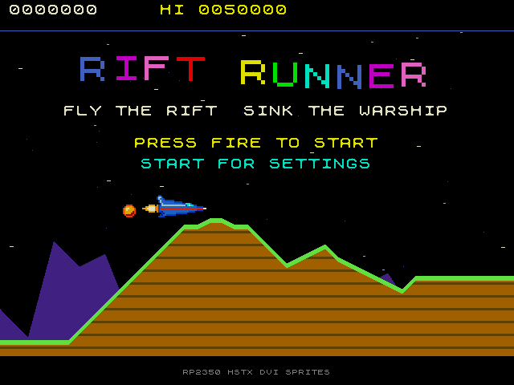
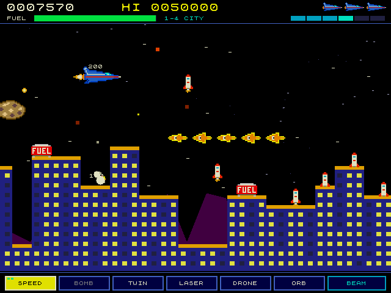
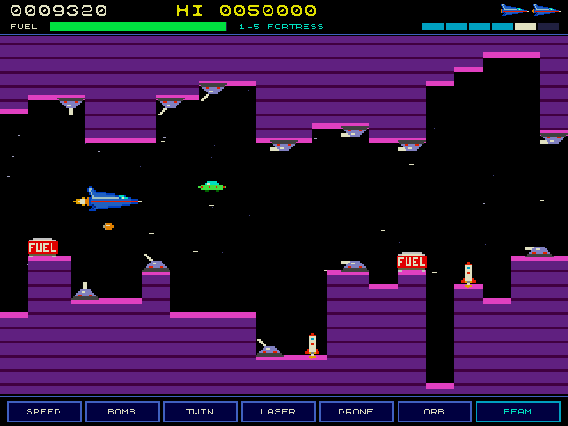
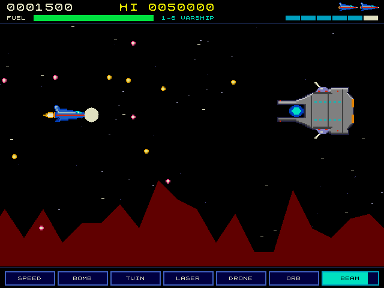

# Rift Runner

A side scrolling shooter with big, bold sprites, drawn twice the size of their pixel art.
Fly through the five sections of the rift, keeping the fuel up, picking power ups from the
power bar, and sink the warship at the end. Then round again, harder.

<p>
  
  
  
  
</p>

## Controls

NES or SNES gamepads (see the top README):

| Pad                | Does                                                  |
|--------------------|-------------------------------------------------------|
| D-pad              | Fly                                                   |
| A (SNES B or A)    | Fire. Hold it to charge the beam, and let go to fire it |
| B (SNES Y or X)    | Drop a bomb                                           |
| Select, L or R     | Take the power up lit on the power bar                |
| Start              | The settings: in a game, it pauses with them over it  |

Fire or bomb starts a game. The settings are music on or off, music while flying on or off, the
tune to fly to (Rift Runner's own, or Night Orbit, Atomic Surf or Clockwork from the songs the
games share), the round a game starts at (1 to 3, for trying the giants without beating the
warship first), whether the demo game is heard, and a sound test.

Built with `-DGAME_BUTTONS=ON`, buttons work as well, each connecting its GPIO to ground
(internal pull ups are used). There are no buttons for start or the power bar, so a pad is
needed for those.

| GPIO | Button |
|------|--------|
| 2    | Left   |
| 3    | Right  |
| 4    | Up     |
| 5    | Down   |
| 6    | Fire   |
| 7    | Bomb   |

They stay clear of GPIO 8, the MIDI synth's. The first button GPIO can be changed with
`RR_INP_GPIO_START` in CMakeLists.txt.

## The game

- The land goes by on its own, made up as it comes. Hitting it, or anything flying, loses a ship.
- Five sections, each its own land and enemies: the ridges (rockets that take off as you come),
  the caverns (turrets on the floor and ceiling), the debris field (meteors that break up),
  the city (rockets on the roofs, saucers that come after you) and the fortress (narrow
  passages and a lot of turrets). Then the warship.
- Fuel burns all the time. Shoot or bomb fuel tanks to fill up. With none left the ship drops.
- Shoot a whole wave of darts, or a red carrier, for a capsule. Each capsule lights the next
  power up on the bar, and select takes it. Each box says what taking it gives next, has a pip for
  each level taken, and goes dark once it can go no further:
  - SPEED, up to 4
  - BOMB drops one up as well as one down, then BIG BOMB blasts harder and wider
  - TWIN adds a shot up and forward, then TRIPLE one down and forward as well
  - LASER goes through things, then BIG LASER is thicker and hits twice as hard. TWIN and LASER
    replace each other.
  - DRONE, up to 2, following the ship and firing with it
  - ORB sits on the nose, stopping bullets and grinding down what it touches, then REAR ORB
    guards the tail too

  Losing a ship loses them all.
- The beam, charged by holding fire, goes through everything in its way, harder the longer it
  was charged.
- From the second time round, giants join in, drawn four times the size: jellyfish that drift in
  groups, squeezing to push themselves up and dropping stings; mosquitoes that hover then dart
  straight at the ship, three times; and wasps that come from behind, overtake, turn to sting and
  dive back past. A whole group shot leaves a capsule.
- The warship's core sits in its jaws behind three walls: shoot the walls away first, while its
  turrets fire at you. What fuel is left is counted into the score.
- An extra ship at 20000 points, and every 50000 after.

## Between games

The title over the ridges going by, the enemies and what they are worth, the giants, a demo game
played by the Pico, how to fly, and the hall of fame.

## Music and sounds

With a General MIDI synth such as a SAM2695 on GPIO 8 (see the top README), there are sounds for
everything, a tune on the title and hall of fame, a driving tune while flying, another for the
warship, a fanfare for sinking it, a few notes at the end of a game, and a tune while putting in
initials. Music can be turned off in the settings. They are in `src/rr_sound_data.c`, and
`../common/tools/render_sounds.sh` renders each to a MIDI file to listen to.

## How it is drawn

- The pictures are pixel art kept as runs of one colour per row (`src/rr_art.c`), drawn as spans
  twice the size, so a big sprite costs about the same as a small one.
- The land is columns 16 pixels wide, sloping or stepping, with a bright rim, darker bands and, in
  the city, lit windows, with hills behind going by at half speed (`src/rr_world.c`). Each frame the
  game's core (core 0) works out the runs of colour on every row of the land and hills, side by side
  so no pixel is drawn twice, and the renderer on core 1 only draws them, as one sprite. One set is
  worked out while the other is shown. This takes core 0 up to about 4.5 ms a frame; worked out by
  the renderer itself, row by row, the city was more than it could draw in time.
- The three layers of stars are one sprite, scrolling slower than the land.
- Explosions are discs of fire that swell and burn out from the middle (`src/rr_fx.c`).
- Text draws straight into the row, so it is added after what it sits on.
- Drawing over pixels already drawn costs far more than drawing them fresh, so the power bar is
  one sprite of runs side by side, explosions are rings round their hot middles, and the hills
  leave out what the land covers.

How hard the renderer works is printed over USB serial each second: the fewest rows it kept ahead
of the display (below 0 a frame was dropped) and the slowest row, as a share of a row's time.

## Running on the PC

The game can be built and run on a Linux PC to try out changes without a Pico.
The sprite renderer runs in a second thread in place of core 1, and frames are saved as PPM images.

```sh
host/build.sh
host/build/riftrunner_host play 6000 300 frames
```

The arguments are the mode, how many frames to run, how often to save one and where to put them.
The modes are `attract` (no buttons pressed), `play` (a game flown by the demo pilot), `tour` (as
play, jumping to the next section every 10 seconds), `boss` (as play, going straight to the
warship), `manual` (charging and letting go of the beam, bombs and some flying) and `settings`
(opens the settings on the title and tries a sound), `powers` (takes power ups in turn, firing)
`pause` (opens the settings in a game and changes the music) and `giants` (as play, sending in
each kind of giant). The score, lives, fuel and section are printed
every 10 seconds of game time, and each ship lost as it happens.

Each saved frame is about 1MB, so keep the gap between them large on long runs.
